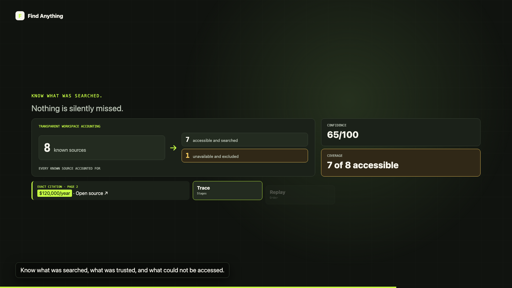
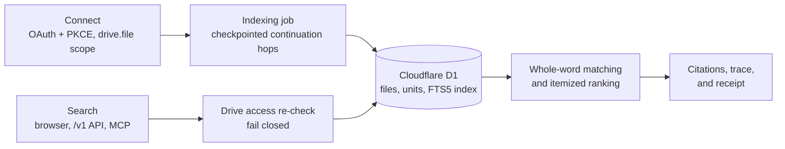

# Find Anything

Permission-aware exact search over the Google Drive files you choose to share with it, with page, slide, and cell citations and a receipt for every search.

[](https://github.com/jeheonlee11-create/find-anything/actions/workflows/ci.yml)
Public beta at [findanything.dev](https://findanything.dev). Google brand verification is still pending, so Google may show its unverified-app notice when you connect.



## Why

When a person or an AI agent searches a team's documents, the answer is only as trustworthy as the search behind it: was every relevant file searched, was any file the user can no longer open used anyway, and where exactly did each fact come from? Find Anything answers those questions for every search. It searches only the files a user picked, re-checks access with Google at query time, cites the exact location of each match, and records what was searched, what was excluded, and why.

## How it works



1. **Connect.** The user signs in and grants the `drive.file` scope, so the app can read only the files they select in Google's picker. OAuth uses a hashed, single-use `state` and PKCE; tokens are encrypted at rest and bound to their database row (`lib/google-drive/oauth.ts`, `lib/security/secret-box.ts`).
2. **Index.** A durable job processes the selected files in short hops that checkpoint and chain on their own, so indexing continues after the tab closes. Docs, Slides, Sheets, and PDFs become text units with structural locations, extracted by local parsers with no LLM (`lib/google-drive/sync.ts`, `lib/indexing/jobs.ts`).
3. **Search.** Every search first re-lists the Drive files the account can reach and drops anything no longer in that list; if the check fails, the search returns an error and no results. An FTS5 index in D1 narrows candidates, then the matcher applies whole-word rules to the stored text and ranks with itemized factors (`lib/workspace-search/run-search.ts`, `search-index.ts`, `core.ts`).
4. **Evidence.** Results cite the page, slide, cell, or paragraph with a content hash. Each search stores a trace (stages, timings, decisions) and a receipt (counts and hashes) that the UI, the `/v1` API, and the MCP server can read back.

More detail: [docs/architecture.md](docs/architecture.md), [docs/api.md](docs/api.md).

## Design decisions and trade-offs

- **Fail closed on permissions instead of caching them.** Search re-checks Drive access on every query, which costs one Drive listing per search (IDs only). A cache would be faster but could serve a file the user lost access to moments ago. Stored rows missing from the listing are excluded and counted, never named.
- **D1 and Workers instead of a separate search service.** One deployable unit and one database keep the beta simple to run. The cost is D1's limits (99 bound parameters per statement, statement batches instead of interactive transactions, a per-invocation subrequest budget), which shape the indexer: statement sizes are derived from the schema, and indexing runs as short, budgeted hops.
- **Leases and conditional writes for job state.** Each indexing hop holds a lease, and its commit only applies while it still holds it, so a hop that outlived its lease cannot overwrite a newer one or fork the chain. Counters can only increase. One active job per connector is enforced by a partial unique index.
- **FTS5 as a candidate generator, not the judge.** The full-text index finds files that might match; the final whole-word decision is made on the stored text. The tokenizer accepts a superset of what the matcher accepts, so a stale index entry can add a candidate but cannot change a result, and tests check that both paths return identical results.

## Queue-based indexer

`queue-worker/` is a separate Cloudflare Worker that moves indexing continuations through Cloudflare Queues instead of self-chaining hops. Failed deliveries retry with exponential backoff (15 s doubling, capped at 15 minutes); messages that exhaust their retries go to a dead-letter queue, whose consumer records a terminal failure on the job instead of letting it hang. A one-minute scheduled reconciler re-enqueues continuations that were committed but never dispatched, for example when the process died in between. Messages carry only job and sequence IDs and an attempt epoch, never tokens, file names, or content, and requests between the Site and the Worker are signed in both directions. It is covered by 20 tests against a simulated queue (`tests/queue-indexing-architecture.test.mjs`) and has a staging configuration. Production still runs the self-chaining hops described above, which need no extra Cloudflare resources during the beta. Design: [docs/indexing-queue-architecture.md](docs/indexing-queue-architecture.md).

## Results

- **Tests:** 264 `node:test` tests pass (`npm test`). They include repository-level tests that apply every migration to an in-memory SQLite database and run the real Drizzle statements: the FTS triggers, the indexed search path against the old full-corpus path, single-use OAuth state, and the one-transaction disconnect.
- **Search cost.** `npm run benchmark:search -- <files> <unitsPerFile>` builds a synthetic workspace in in-process SQLite and times the old path (load every unit, match in memory) against the current one (FTS5 candidates, then only units containing a term). Both must return identical results or the script fails. Median of 7 runs on an Apple M2 Pro, Node 24.16; this excludes D1 network latency and the Drive permission listing, which both paths share.

  | Workspace | Query | Old path | Indexed path | Units loaded (old / new) |
  |---|---|---|---|---|
  | 2,000 files, 40,000 units | rare phrase (20 matches) | 103 ms | 6 ms | 40,000 / 20 |
  | 2,000 files, 40,000 units | word in every file | 201 ms | 82 ms | 40,000 / 8,235 |
  | 10,000 files, 100,000 units | rare phrase (100 matches) | 286 ms | 30 ms | 100,000 / 100 |
  | 10,000 files, 100,000 units | word in almost every file | 580 ms | 329 ms | 100,000 / 20,590 |
  | 10,000 files, 100,000 units | no match | 224 ms | 26 ms | 100,000 / 0 |

## Limitations and next steps

- **Search cost still grows with matches.** A word that appears in most files still loads most of their units; an empty query (browse) loads up to five units per file; and the workspace filter runs after the FTS match, so a term common across many workspaces scans all their matches. Next: per-workspace FTS terms and paging candidates in SQL.
- **One Drive listing per search.** The permission re-check is deliberately uncached, so search latency includes a Drive API call (one per 1,000 picked files).
- **No semantic search.** Matching is literal and whole-word; synonyms and paraphrases do not match.
- **Change detection runs on re-sync**, not on the Drive Changes push feed.
- **Not externally reviewed.** No penetration test or security assessment has been done. `npm audit --omit=dev` reports 0 advisories after the Next.js 16.4.1 upgrade; the full `npm audit` still reports 4 moderate ones in `drizzle-kit`'s esbuild loader, a dev-only migration CLI with no patched release yet.
- **D1 export does not support virtual tables**, so `wrangler d1 export` will not work on this database while the FTS table exists.
- **Some tests still assert on source text** (older suites); new behavior is covered by behavioral tests, but not every route has one.

## Run it

```bash
git clone https://github.com/jeheonlee11-create/find-anything.git
cd find-anything
npm ci
npm run typecheck && npm run lint && npm test
npm run dev                     # http://localhost:3000
```

Tests need no accounts or secrets. Connecting a real Drive needs a Google Cloud OAuth client, a Picker API key, and a 32-byte `TOKEN_ENCRYPTION_KEY` in `.env.local` (copy `.env.example`); the full sign-in flow needs the hosted environment. See [docs/setup.md](docs/setup.md).

Main routes: `/` (site), `/connect`, `/app` (product), `/settings` (including disconnect-and-delete), `/v1/*` (API-key REST), `/api/mcp` (MCP), `/api/health`, `/api/readiness`.

## How it was built

Built by Jeheon Lee with AI coding assistants (Claude Code, OpenAI Codex). I set the direction and design, and verified behavior with the tests and benchmark above.

## License

Copyright (c) 2026 Jeheon Lee. All rights reserved. Source shown for review.
