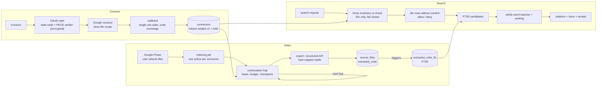

# Architecture

Find Anything is one Next.js-compatible application built with vinext and run
as a Cloudflare Worker, with Cloudflare D1 (SQLite) as its only database,
accessed through Drizzle. The public site and the product share one origin:
public pages at `/`, the product under `/app`, the developer API under `/v1`,
and the MCP server at `/api/mcp`.

## Connecting Google Drive

- `/connect` checks platform identity, then the beta access gate
  (`lib/beta/access-gate.ts`, controlled by `BETA_ACCESS_MODE`), then workspace
  membership, then starts OAuth (`lib/google-drive/connect-flow.ts`).
- The authorization request (`lib/google-drive/oauth.ts`) asks for one scope,
  `https://www.googleapis.com/auth/drive.file`, so the app can read only files
  the user picks in Google's picker. It carries a random `state` and a PKCE S256
  challenge. Only the hash of `state` is stored; the PKCE verifier is stored
  encrypted.
- The callback consumes the state with a single `DELETE ... RETURNING`
  (`lib/google-drive/oauth-state.ts`), so a state works at most once, then checks
  the actor and expiry and exchanges the code.
- Access and refresh tokens are encrypted with AES-256-GCM in a versioned
  format that names its key and binds the ciphertext to its row and field with
  additional authenticated data (`lib/security/secret-box.ts`). Older `v1`
  values still decrypt and are rewritten as `v2` on the next token refresh.
- Token refresh is single-flight: an in-memory map per isolate plus a D1 lease
  row (`oauth_refresh_leases`) across isolates. A revoked grant or missing
  scope marks the connector `reauthorization_required`; a Google 5xx, 429, or
  network error leaves it usable (`lib/google-drive/connector-health.ts`).

## Indexing

Indexing is a durable job (`indexing_jobs`, at most one active per connector,
enforced by a partial unique index) advanced in short hops
(`lib/google-drive/sync.ts`, `lib/indexing/jobs.ts`). Each hop:

1. takes the continuation's execution lease; a commit is fenced on still holding
   it (`lib/indexing/continuation-fence.ts`), so a hop whose lease expired
   cannot overwrite the job or fork the chain;
2. spends from an explicit Workers subrequest budget
   (`lib/indexing/subrequest-budget.ts`, default 45) and a 12-second time box;
3. lists Drive pages (resumable from a checkpointed `nextPageToken`), writes
   name-searchable metadata rows first, then extracts changed files
   (`modifiedTime` or `md5Checksum` changed) through a bounded adaptive pool;
4. writes each file's units and status in one D1 batch, chunked to D1's
   limits (`lib/indexing/d1-limits.ts`: 99 bound parameters per statement,
   40 statements per batch);
5. checkpoints counters (which only move up) and persists the next
   continuation before returning.

Hops chain on their own inside the request's `waitUntil` window and through
detached continuation requests (`worker/indexing-continuation.ts`), so
indexing continues after the dashboard tab closes. A managed Cloudflare Queue
design exists in `queue-worker/` and `docs/indexing-queue-architecture.md` but is
not deployed.

Extraction uses local parsers only: the Docs, Slides, and Sheets APIs for
structure (paragraphs, slide elements and notes, cells), plain-text or CSV
export as a labeled fallback, and `unpdf` for PDF text blocks. Every read is
byte-capped (`readBoundedBody` in `lib/google-drive/client.ts`): 4 MB for native
exports and structured JSON, 24 MB for downloads. Native files reserve their
4 MB cap in the pool's 32 MB in-flight budget. AI enrichment for scanned files
exists behind a flag and is off by default.

## Search

One pipeline serves the browser, `/v1/search`, and MCP
(`lib/workspace-search/run-search.ts`):

1. **Permission re-check.** List the Drive file IDs the connected account can
   reach right now (`lib/google-drive/permission.ts`, IDs-only field mask). Any
   error or incomplete listing fails the search with
   `PERMISSION_REVALIDATION_FAILED` and no results.
2. **Inventory.** Read the workspace's file rows without content
   (`workspaceInventory` in `lib/workspace-search/search-index.ts`) and split them
   into allowed and denied by Drive ID. Denied rows are counted, never named.
3. **Candidates.** Ask the FTS5 index which files contain each query term, keep
   files where every term is in the content or the name/MIME type, and load
   text only for units that contain a term.
4. **Match and rank.** The matcher in `lib/workspace-search/core.ts` applies
   whole-word rules (`lib/workspace-search/matching.ts`): "cat" does not match
   "category". The score is `ranking.finalScore`
   (`lib/workspace-search/ranking.ts`), and `ranking.factors` itemizes every
   point. Best Matches sorts by score, then modified time, then ID; Find All
   sorts by name, then ID.
5. **Evidence.** Up to five citations per result, each with its structural
   location (page, slide, cell, paragraph), excerpt, and content hash.
6. **Records.** A retrieval trace and a search receipt are written
   (`lib/workspace-search/audit.ts`), with real per-stage timings. Per-file
   decision lists are bounded to the returned page; full counts go to
   `decision_summary_json`, so a trace stays a small row on any workspace size.

### The full-text index

`extracted_units_fts` (migration `drizzle/0021_extracted_units_fts.sql`) is a
standalone FTS5 table with the `unicode61` tokenizer, kept in sync by triggers
on `extracted_units`. It shares each unit's rowid; deletes also check
`unit_id`. The index is only a candidate generator: its tokenizer folds case
and accents, so it accepts a superset of what the whole-word rule accepts, and
the final decision is always made on `extracted_units` text. A stale index row
can widen the candidate set but cannot change a result.

Known costs: candidate loading is proportional to the units that contain a
query term (a word in every file still loads every unit with it); browsing with
an empty query loads up to five units per file; the workspace filter runs after
the FTS match, so a term common across many workspaces scans all of their
matches; and D1's export command does not support databases with virtual
tables. `scripts/benchmark-search.mjs` measures both paths on synthetic data.

## Data model

`db/schema.ts` is the source of truth; migrations live in `drizzle/` and are
forward-only and additive (`npm run db:validate` rejects destructive SQL).

| Table | Holds |
|---|---|
| `connectors` | One Google connection per workspace; sealed tokens, status, granted scopes |
| `source_files` | One row per Drive file: name, MIME type, Drive ID, index status, searchable status |
| `extracted_units` | Text units with structural location and SHA-256 content hash |
| `extracted_units_fts` | FTS5 index over unit text (virtual table, not in `db/schema.ts`) |
| `indexing_jobs`, `indexing_continuations` | Durable job state, leases, checkpoints |
| `retrieval_traces`, `search_receipts` | Per-search records |
| `retrieval_conflicts`, `file_relationships` | Deterministic conflicts and inferred lineage |
| `api_keys`, `api_rate_limits` | Workspace-scoped API keys (HMAC only) and per-minute counters |

Disconnect deletes everything a connector produced in one D1 batch, which D1
runs as a single transaction (`connectorDeletionStatements` in
`lib/google-drive/statement-builders.ts`), and only after Google confirms token
revocation.

## Related design notes

- [Indexer v2 pipeline](indexer-v2-pipeline.md) and [indexing queue architecture](indexing-queue-architecture.md)
- [Ranking explanations](ranking-explanations.md), [retrieval confidence](retrieval-confidence.md), [retrieval replay](retrieval-replay.md), [retrieval diffs](retrieval-diff.md)
- [Deterministic conflicts](deterministic-conflicts.md), [workspace coverage map](workspace-coverage-map.md)
- [Threat model](threat-model.md)
